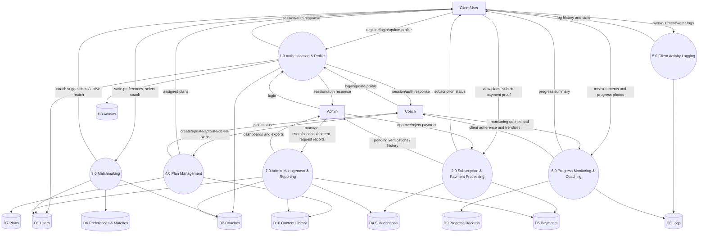

# Wellness System Data Flow Diagram (DFD)

This DFD is based on the implemented backend modules in `routes/api.php` and the current database schema.

## Level 0 DFD (Context Diagram)

```mermaid
flowchart LR
    client[Client/User]
    coach[Coach]
    admin[Admin]
    payment[Payment Channel - GCash Manual]

    system((Wellness Coaching System))

    client -->|register/login, profile, preferences, logs, progress| system
    system -->|auth status, matches, plans, stats, progress summary| client

    coach -->|login, plans, monitoring requests, notes| system
    system -->|client data, adherence metrics, plan status| coach

    admin -->|login, payment verification, user/coach/content/report actions| system
    system -->|pending payments, dashboard stats, reports| admin

    payment -->|reference details / payment proof source| system
    system -->|verification outcome (recorded internally)| payment
```

## Level 1 DFD (Major Processes)



## Data Store Mapping to Tables

- **D1 Users**: `users`, `personal_access_tokens`, `sessions`
- **D2 Coaches**: `coaches`
- **D3 Admins**: `admins`
- **D4 Subscriptions**: `subscriptions`
- **D5 Payments**: `payments`
- **D6 Preferences & Matches**: `user_preferences`, `matches`
- **D7 Plans**: `workout_plans`, `meal_plans`
- **D8 Logs**: `workout_logs`, `meal_logs`
- **D9 Progress Records**: `measurements`, `progress_photos`, `coach_notes`
- **D10 Content Library**: `exercises`, `foods`, `generic_content`

## Notes

- Premium feature gate (`subscription` middleware) controls access to matching, plans, logs, and progress flows.
- Messaging (`messages`) is available in schema but omitted from this DFD since current API routes shown focus on core coaching/payment lifecycle.
- If you need, this can be split into separate DFDs per module (Subscription, Coaching, Admin).
