# Wellness System ERD

This ERD is based on the current Laravel migrations in `database/migrations`.

## Mermaid ER Diagram

```mermaid
erDiagram
    USERS {
        bigint id PK
        string name
        string email UK
        string password
    }

    ADMINS {
        bigint id PK
        string name
        string email UK
        enum role
    }

    COACHES {
        bigint id PK
        bigint created_by FK
        string name
        string email UK
        enum status
        float rating
    }

    USER_PREFERENCES {
        bigint id PK
        bigint user_id FK
        enum coaching_style
        enum communication_frequency
        enum communication_style
    }

    SUBSCRIPTIONS {
        bigint id PK
        bigint user_id FK
        bigint verified_by FK
        enum plan_type
        enum status
        decimal amount
        timestamp start_date
        timestamp end_date
    }

    PAYMENTS {
        bigint id PK
        bigint user_id FK
        bigint subscription_id FK
        bigint verified_by FK
        decimal amount
        enum payment_status
        string transaction_reference UK
        string gcash_reference_number UK
    }

    MATCHES {
        bigint id PK
        bigint client_id FK
        bigint coach_id FK
        enum status
        date start_date
        date end_date
    }

    WORKOUT_PLANS {
        bigint id PK
        bigint coach_id FK
        bigint client_id FK
        bigint match_id FK
        string title
        enum plan_type
        enum status
        date start_date
        date end_date
    }

    MEAL_PLANS {
        bigint id PK
        bigint coach_id FK
        bigint client_id FK
        bigint match_id FK
        string title
        enum plan_type
        enum status
        date start_date
        date end_date
    }

    WORKOUT_LOGS {
        bigint id PK
        bigint client_id FK
        bigint workout_plan_id FK
        date date
    }

    MEAL_LOGS {
        bigint id PK
        bigint client_id FK
        bigint meal_plan_id FK
        date date
        enum meal_time
    }

    CHECK_INS {
        bigint id PK
        bigint coach_id FK
        bigint client_id FK
        timestamp scheduled_date
        timestamp completed_date
    }

    PROGRESS_PHOTOS {
        bigint id PK
        bigint user_id FK
        bigint coach_id FK
        string photo_path
        enum photo_type
        date photo_date
    }

    MEASUREMENTS {
        bigint id PK
        bigint user_id FK
        date measurement_date
        float weight
        float bmi
    }

    COACH_NOTES {
        bigint id PK
        bigint coach_id FK
        bigint client_id FK
        text note
    }

    MESSAGES {
        bigint id PK
        bigint sender_id
        string sender_type
        bigint receiver_id
        string receiver_type
        text content
        boolean is_read
    }

    PERSONAL_ACCESS_TOKENS {
        bigint id PK
        bigint tokenable_id
        string tokenable_type
        string token UK
    }

    EXERCISES {
        bigint id PK
        string name
        string category
        enum difficulty
    }

    FOODS {
        bigint id PK
        string name
        string category
    }

    GENERIC_CONTENT {
        bigint id PK
        string title
        enum category
        enum content_type
    }

    ADMINS ||--o{ COACHES : creates
    USERS ||--o| USER_PREFERENCES : has

    USERS ||--o{ SUBSCRIPTIONS : has
    ADMINS o|--o{ SUBSCRIPTIONS : verifies

    USERS ||--o{ PAYMENTS : makes
    SUBSCRIPTIONS o|--o{ PAYMENTS : includes
    ADMINS o|--o{ PAYMENTS : verifies

    USERS ||--o{ MATCHES : client
    COACHES ||--o{ MATCHES : coach

    COACHES ||--o{ WORKOUT_PLANS : creates
    USERS ||--o{ WORKOUT_PLANS : assigned_to
    MATCHES o|--o{ WORKOUT_PLANS : source

    COACHES ||--o{ MEAL_PLANS : creates
    USERS ||--o{ MEAL_PLANS : assigned_to
    MATCHES o|--o{ MEAL_PLANS : source

    USERS ||--o{ WORKOUT_LOGS : logs
    WORKOUT_PLANS o|--o{ WORKOUT_LOGS : based_on

    USERS ||--o{ MEAL_LOGS : logs
    MEAL_PLANS o|--o{ MEAL_LOGS : based_on

    COACHES ||--o{ CHECK_INS : schedules
    USERS ||--o{ CHECK_INS : attends

    USERS ||--o{ PROGRESS_PHOTOS : uploads
    COACHES o|--o{ PROGRESS_PHOTOS : reviews

    USERS ||--o{ MEASUREMENTS : records

    COACHES ||--o{ COACH_NOTES : writes
    USERS ||--o{ COACH_NOTES : subject

    USERS ||--o{ MESSAGES : sender_receiver_morph
    COACHES ||--o{ MESSAGES : sender_receiver_morph
    ADMINS ||--o{ MESSAGES : sender_receiver_morph

    USERS ||--o{ PERSONAL_ACCESS_TOKENS : tokenable_morph
    COACHES ||--o{ PERSONAL_ACCESS_TOKENS : tokenable_morph
    ADMINS ||--o{ PERSONAL_ACCESS_TOKENS : tokenable_morph
```

## Notes

- `messages` and `personal_access_tokens` use polymorphic relations (`*_id` + `*_type`) rather than strict foreign keys.
- `sessions.user_id` is indexed but not constrained with a foreign key.
- `exercises`, `foods`, and `generic_content` are standalone catalog/content tables in the current schema.
- Several tables include additional JSON and metadata columns omitted in the diagram for readability.
