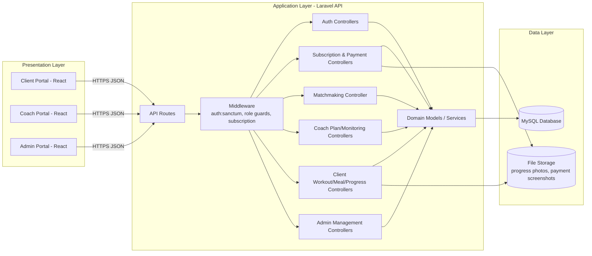
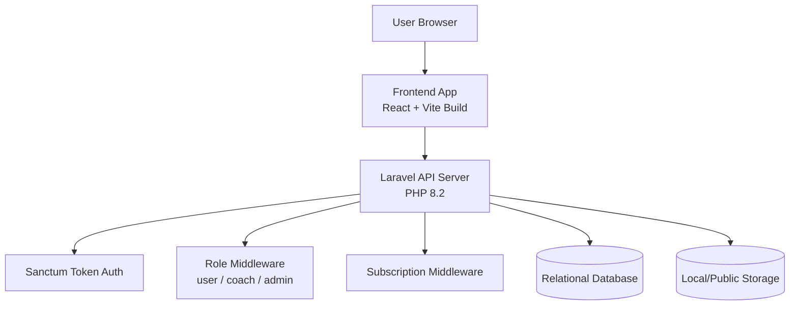
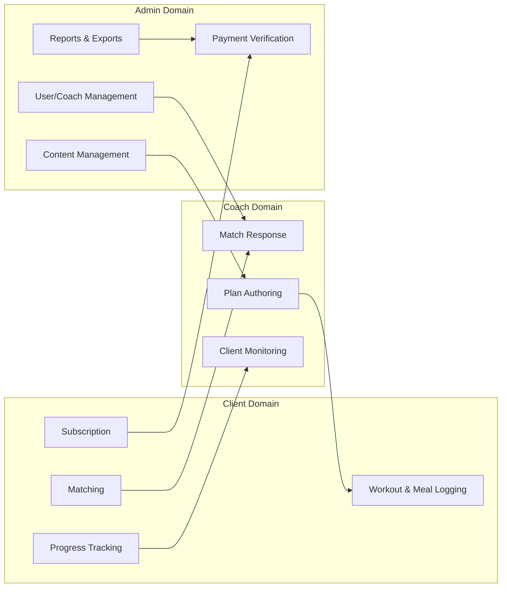

# Wellness System Architecture

This architecture is aligned with the current project structure and implemented API modules.

## 1) Architecture Style

The system follows a **3-tier web architecture** with clear separation of concerns:

- **Presentation Layer**: React + Vite frontend (`frontend/`)
- **Application Layer**: Laravel REST API (`backend/`)
- **Data Layer**: Relational database via Laravel Eloquent + Migrations

It also applies **role-based access control** and **token-based authentication** using Laravel Sanctum.

## 2) High-Level Logical Architecture

## 3) Deployment / Runtime Architecture

## 4) Core Module Architecture

## 5) Key Request Flow (End-to-End)

### A. Premium Client Journey
1. Client authenticates (`auth:sanctum`).
2. Client submits subscription payment.
3. Admin verifies payment and activates subscription.
4. Subscription middleware unlocks premium routes.
5. Client sets preferences, gets coach suggestions, selects a coach.
6. Coach accepts match and publishes workout/meal plans.
7. Client logs activities and submits progress updates.
8. Coach monitors adherence and adds coaching notes.

### B. Security and Access Controls
- **Authentication**: token-based with Sanctum.
- **Authorization**: route middleware for `user`, `coach`, and `admin` areas.
- **Feature gating**: `subscription` middleware for premium-only modules.
- **Audit-sensitive actions**: payment verification and admin actions stored in DB.

## 6) Data Architecture Summary

- **Identity and role data**: `users`, `coaches`, `admins`, `personal_access_tokens`
- **Commercial data**: `subscriptions`, `payments`
- **Coaching data**: `user_preferences`, `matches`, `workout_plans`, `meal_plans`
- **Activity and outcomes**: `workout_logs`, `meal_logs`, `measurements`, `progress_photos`, `coach_notes`
- **Reference content**: `exercises`, `foods`, `generic_content`

## 7) Non-Functional Considerations

- **Scalability**: stateless API design supports horizontal scaling at app tier.
- **Maintainability**: role-separated controller modules and migration-driven schema changes.
- **Extensibility**: architecture can add notifications/chat/analytics as new bounded modules.
- **Observability**: Laravel logging and request middleware chain support operational tracing.

## 8) Related Documents

- [ERD.md](ERD.md)
- [USE_CASE_DIAGRAM.md](USE_CASE_DIAGRAM.md)
- [DATA_FLOW_DIAGRAM.md](DATA_FLOW_DIAGRAM.md)
