# Wellness System Use Case Diagram

This use case diagram is derived from implemented API capabilities in `routes/api.php`.

## Mermaid Use Case Diagram

```mermaid
flowchart LR
    %% Actors
    client[Client / User]
    coach[Coach]
    admin[Admin]

    %% System boundary
    subgraph system[Wellness Coaching System]
        %% Client use cases
        uc_register([Register Account])
        uc_login([Login / Logout])
        uc_profile_client([Manage Profile])

        uc_view_plans([View Subscription Plans])
        uc_submit_payment([Submit Payment Proof])
        uc_view_sub_status([View Subscription Status])

        uc_set_prefs([Set Coaching Preferences])
        uc_view_suggestions([View Coach Suggestions])
        uc_select_coach([Select Coach Match])
        uc_view_match([View Active Match])

        uc_view_workout_plan([View Workout Plans])
        uc_log_workout([Log Workout])
        uc_view_workout_stats([View Workout Stats])

        uc_view_meal_plan([View Meal Plans])
        uc_log_meal([Log Meal / Water])
        uc_view_nutrition_stats([View Nutrition Stats])

        uc_add_measurement([Record Measurements])
        uc_upload_photo([Upload Progress Photos])
        uc_view_progress([View Progress Summary])

        %% Coach use cases
        uc_profile_coach([Manage Coach Profile])
        uc_view_clients([View Assigned Clients])

        uc_accept_match([Accept / Reject Match])

        uc_create_workout_plan([Create/Update Workout Plan])
        uc_create_meal_plan([Create/Update Meal Plan])
        uc_activate_plan([Activate/Delete Plan])
        uc_view_library([View Exercise/Food Library])

        uc_monitor_client([Monitor Client Progress])
        uc_view_adherence([View Adherence Metrics])
        uc_add_notes([Add Coach Notes])

        %% Admin use cases
        uc_admin_login([Login / Logout])
        uc_verify_payments([Verify/Reject Payments])
        uc_manual_subscription([Create Manual Subscription])
        uc_view_dashboard([View Payment Dashboard Stats])

        uc_manage_users([Manage Users])
        uc_manage_user_subs([Manage User Subscription])

        uc_manage_coaches([Manage Coaches])
        uc_suspend_coach([Suspend Coach])

        uc_manage_content([Manage Content Library])
        uc_bulk_upload([Bulk Upload Content])

        uc_generate_reports([Generate Reports])
        uc_export_reports([Export Reports])
    end

    %% Actor associations - Client
    client --- uc_register
    client --- uc_login
    client --- uc_profile_client

    client --- uc_view_plans
    client --- uc_submit_payment
    client --- uc_view_sub_status

    client --- uc_set_prefs
    client --- uc_view_suggestions
    client --- uc_select_coach
    client --- uc_view_match

    client --- uc_view_workout_plan
    client --- uc_log_workout
    client --- uc_view_workout_stats

    client --- uc_view_meal_plan
    client --- uc_log_meal
    client --- uc_view_nutrition_stats

    client --- uc_add_measurement
    client --- uc_upload_photo
    client --- uc_view_progress

    %% Actor associations - Coach
    coach --- uc_login
    coach --- uc_profile_coach
    coach --- uc_view_clients
    coach --- uc_accept_match
    coach --- uc_create_workout_plan
    coach --- uc_create_meal_plan
    coach --- uc_activate_plan
    coach --- uc_view_library
    coach --- uc_monitor_client
    coach --- uc_view_adherence
    coach --- uc_add_notes

    %% Actor associations - Admin
    admin --- uc_admin_login
    admin --- uc_verify_payments
    admin --- uc_manual_subscription
    admin --- uc_view_dashboard
    admin --- uc_manage_users
    admin --- uc_manage_user_subs
    admin --- uc_manage_coaches
    admin --- uc_suspend_coach
    admin --- uc_manage_content
    admin --- uc_bulk_upload
    admin --- uc_generate_reports
    admin --- uc_export_reports

    %% Include / dependency style links
    uc_select_coach -. requires .-> uc_set_prefs
    uc_view_workout_plan -. requires .-> uc_view_match
    uc_view_meal_plan -. requires .-> uc_view_match

    uc_activate_plan -. includes .-> uc_create_workout_plan
    uc_activate_plan -. includes .-> uc_create_meal_plan

    uc_verify_payments -. may trigger .-> uc_manual_subscription
    uc_generate_reports -. includes .-> uc_export_reports
```

## Actors Summary

- **Client / User**: subscribes, finds a coach, follows plans, logs workouts/meals, and tracks progress.
- **Coach**: accepts matched clients, creates plans, and monitors client adherence/progress.
- **Admin**: verifies payments, manages users/coaches/content, and produces system reports.

## Notes

- Premium-only client features (matching, plans, logs, progress) depend on active subscription middleware.
- Diagram is use-case focused (functional behavior), while data structure is documented separately in [ERD.md](ERD.md).
